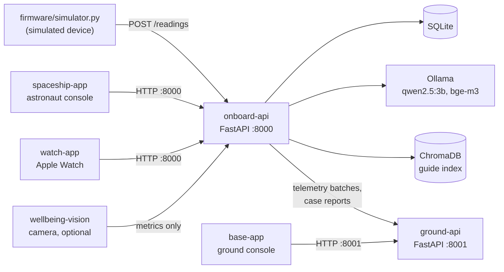

# Space Apps 2026: onboard crew health console

NASA Space Apps 2026. A crew health system for a spacecraft that cannot count on a doctor on board or a live link to Earth.

- A **device feed** (simulated today) posts pulse-oximeter, urine-analyser and muscle-scanner readings.
- **onboard-api** stores the readings, flags out-of-range or stale sensors, and runs a **local medical assistant**: rules and versioned protocol cards decide urgency and actions; a local LLM (Ollama) and a local guide index (ChromaDB) add explanations. Alarms and SOS work even when the models are down.
- The **astronaut console** (spaceship-app, Tauri desktop app) shows crew status, the assistant chat, urgent incidents and a wellbeing module. An **Apple Watch app** shows readings and sends an SOS.
- **Telemetry** goes to **ground-api** when the link is up. The crew can also review a case report from the assistant and send it to base; it waits in an onboard queue until ground acknowledges it. The **ground console** (base-app) shows crew, alerts, incidents, received case reports and the review screen for assistant releases.

Everything runs locally. No cloud LLM or vector database is called. The assistant gives informational support only; diagnosis and treatment decisions stay with qualified personnel.

## How it fits together



Details, request traces and failure behavior: [docs/ARCHITECTURE.md](docs/ARCHITECTURE.md).

| Path | What | Guide |
|---|---|---|
| `services/onboard-api/` | Onboard FastAPI service: readings, status, assistant, incidents, wellbeing, telemetry publisher | [README](services/onboard-api/README.md) |
| `services/ground-api/` | Ground FastAPI service: telemetry receiver, ground read API, medical-eval review | [README](services/ground-api/README.md) |
| `services/wellbeing-vision/` | Optional camera collector for the wellbeing module | [README](services/wellbeing-vision/README.md) |
| `apps/spaceship-app/` | Astronaut console (Tauri 2, React 19) | [README](apps/spaceship-app/README.md) |
| `apps/base-app/` | Ground console (Tauri 2, React 19) | [README](apps/base-app/README.md) |
| `apps/watch-app/` | Apple Watch app (watchOS 10+, macOS and Xcode only) | [README](apps/watch-app/README.md) |
| `firmware/` | Software stand-in for the biomonitor device | [Architecture](docs/ARCHITECTURE.md#2-reading-ingestion) |
| `db/` | SQLite migrations and data dictionary | [data-dictionary.md](db/data-dictionary.md) |
| `contracts/` | Telemetry, case-report and medical-eval contracts | [telemetry](contracts/telemetry/README.md), [case-report](contracts/case-report/README.md), [medical-eval](contracts/medical-eval/README.md) |
| `eval/medical/` | Synthetic evaluation cases for the assistant | [README](eval/medical/README.md) |

Hardware collectors for real sensors (serial devices, pose camera) are **planned**; no code exists yet. All readings come from the simulator or the demo seeder.

## Quickstart

### Prerequisites

| Tool | Needed for |
|---|---|
| Git | Cloning |
| Docker Desktop (running) | The Docker Compose path |
| Node.js with npm | Both desktop consoles |
| Rust via [rustup](https://rustup.rs) and the [Tauri prerequisites](https://v2.tauri.app/start/prerequisites/) | Both desktop consoles |
| [uv](https://docs.astral.sh/uv/) with Python 3.12 | The local development path, tests, wellbeing-vision |
| [Ollama](https://ollama.com) | The local development path, if you want LLM explanations and guide search |

Free ports: 8000 (onboard-api), 8001 (ground-api), 1420 (spaceship-app), 1421 (base-app).

```sh
git clone https://github.com/rubenyh/SpaceApps-2026.git
cd SpaceApps-2026
```

### Quickstart: Docker Compose

Docker Compose runs onboard-api, ground-api, Ollama, the one-shot `demo-init` job (model pull and guide index) and the simulator. The consoles run on the host.

Windows, one command from the repo root in PowerShell (starts the stack and opens both consoles):

```powershell
.\run.ps1
```

macOS: `./run.sh`. Any OS, step by step:

```sh
docker compose up --build -d          # repo root
cd apps/spaceship-app
npm install
npm run tauri dev                     # astronaut console; repeat in apps/base-app for the ground console
```

The first run downloads about 7 GB (Ollama image, `qwen2.5:3b`, `bge-m3`, the MedlinePlus XML) and then builds the guide index, which takes a few minutes. The APIs and the simulator work before that finishes; until then, assistant replies say that guides are not available. All options, the services and their volumes: [docs/RUN-REPO.md](docs/RUN-REPO.md).

### Quickstart: local development

Without Docker. Each command runs in its own terminal, in the directory shown.

```sh
# 1. services/onboard-api
uv sync --locked
uv run fastapi dev                    # http://127.0.0.1:8000

# 2. services/ground-api
uv sync --locked
uv run fastapi dev --port 8001        # http://127.0.0.1:8001

# 3. repo root: simulated device feed (registers ast-01 and ast-02)
python3 firmware/simulator.py

# 4. apps/spaceship-app (and apps/base-app for the ground console)
npm install
npm run tauri dev
```

On Windows PowerShell, the commands are the same except: set `$env:PYTHONUTF8 = "1"` in each Python terminal, and run the simulator with `python firmware\simulator.py`.

The assistant answers alarms and card decisions without anything else. For drafted explanations and guide search, start Ollama and build the index once:

```sh
ollama pull qwen2.5:3b
ollama pull bge-m3
cd services/onboard-api
uv run python -m onboard_api.assistant.ingest    # downloads MedlinePlus XML, fills data/chroma
```

Details: [docs/RAG-AND-EVALUATION.md](docs/RAG-AND-EVALUATION.md).

### Confirm it is running

```sh
curl http://127.0.0.1:8000/                          # {"status":"ok"}
curl http://127.0.0.1:8000/astronauts                # ast-01 and ast-02 once the simulator runs
curl http://127.0.0.1:8001/link                      # batches_received grows every 5 s
docker compose ps -a                                 # Compose only: demo-init "Exited (0)" when setup is done
```

```powershell
Invoke-RestMethod http://127.0.0.1:8000/
Invoke-RestMethod http://127.0.0.1:8001/link
```

In the console, select `ast-01`: vital signs update every 5 s. Ask the assistant "I have a headache"; it asks one follow-up question. The API pages are at <http://127.0.0.1:8000/docs> and <http://127.0.0.1:8001/docs>.

### Stop

```sh
docker compose down          # keeps data, guide index and models (volumes)
docker compose down -v       # also deletes them
```

`.\run.ps1 -Down` does the same as `docker compose down`. Stop native processes with Ctrl+C and close the console windows.

## Documentation

| Guide | What |
|---|---|
| [docs/RUN-REPO.md](docs/RUN-REPO.md) | All ways to run the system: Compose services, consoles, camera, watch, ports |
| [docs/ARCHITECTURE.md](docs/ARCHITECTURE.md) | Components, data flows, the LangGraph assistant, RAG paths, state, failure behavior |
| [docs/CONFIGURATION.md](docs/CONFIGURATION.md) | Every environment variable, where it is used and its default |
| [docs/RAG-AND-EVALUATION.md](docs/RAG-AND-EVALUATION.md) | Guide corpus, index rebuild, retrieval and medical case evaluations |
| [docs/TROUBLESHOOTING.md](docs/TROUBLESHOOTING.md) | Cargo for Tauri, Ollama models, empty index, ports, Windows encoding |
| [CONTRIBUTING.md](CONTRIBUTING.md) | Checks, branch, commit and merge conventions |
| [docs/assistant-frontend-integration.md](docs/assistant-frontend-integration.md) | Assistant request and response contract, as used by the console (Spanish) |
| [docs/demo-outage.md](docs/demo-outage.md) | Demos: urgent incident while the Earth link is down; case report sent to base across an outage |
| [docs/wellbeing-contract.md](docs/wellbeing-contract.md), [docs/wellbeing-demo-runbook.md](docs/wellbeing-demo-runbook.md) | Wellbeing module API and demo (Spanish) |
| [docs/medical-verification.md](docs/medical-verification.md) | Dated test run record for the medical assistant |
| [PRODUCT.md](PRODUCT.md) | Product and design brief used by the Impeccable design skill |
