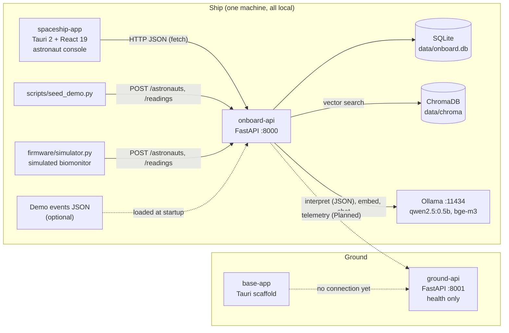

# Architecture

This document follows the system from startup through a user action. It shows where decisions are made and which files to change. It describes the working tree as of 2026-11-14. If this document and the code disagree, the code wins.

Status labels used below:

- **Implemented**: wired into a runnable entry point.
- **Scaffold**: template code only, no project logic.
- **Planned**: described in project docs, no code in the repo.

The medical assistant gives informational support only. Diagnosis and treatment decisions stay with qualified personnel.

## System overview



The live connections are HTTP calls into onboard-api: from the console (reads and assistant) and from the demo producers (writes). The ground side has no link to the ship yet.

## Component map

| Component | Status | Responsibility | Entry point | Main files |
|---|---|---|---|---|
| Astronaut console | Implemented | Shows crew status, readings history and the assistant chat. Read-only for readings. | [`main.tsx`](../apps/spaceship-app/src/main.tsx) mounts [`App.tsx`](../apps/spaceship-app/src/App.tsx). Rust shell: [`main.rs`](../apps/spaceship-app/src-tauri/src/main.rs), [`lib.rs`](../apps/spaceship-app/src-tauri/src/lib.rs). | [`api/client.ts`](../apps/spaceship-app/src/api/client.ts), [`api/types.ts`](../apps/spaceship-app/src/api/types.ts), [`hooks/usePolling.ts`](../apps/spaceship-app/src/hooks/usePolling.ts), [`screens/`](../apps/spaceship-app/src/screens/), [`lib/assistant.ts`](../apps/spaceship-app/src/lib/assistant.ts), [`lib/estado.ts`](../apps/spaceship-app/src/lib/estado.ts) |
| Tauri shell (console) | Implemented, minimal | Opens the window. Registers only the `opener` plugin. No custom Rust commands: all data goes through `fetch` in the webview. | [`lib.rs`](../apps/spaceship-app/src-tauri/src/lib.rs) | [`tauri.conf.json`](../apps/spaceship-app/src-tauri/tauri.conf.json), [`capabilities/default.json`](../apps/spaceship-app/src-tauri/capabilities/default.json) |
| onboard-api | Implemented | Crew, sensor config and readings API over SQLite. Status evaluation. Assistant endpoint. | `onboard_api.main:app` in [`main.py`](../services/onboard-api/src/onboard_api/main.py) | [`config.py`](../services/onboard-api/src/onboard_api/config.py), [`dependencies.py`](../services/onboard-api/src/onboard_api/dependencies.py), [`routers/`](../services/onboard-api/src/onboard_api/routers/), [`services/`](../services/onboard-api/src/onboard_api/services/), [`repositories/`](../services/onboard-api/src/onboard_api/repositories/), [`schemas/`](../services/onboard-api/src/onboard_api/schemas/) |
| Assistant parent graph | Implemented | Routes a message to `medical`, `clarify` or `unsupported`. Deterministic, no LLM. | [`assistant/graph.py`](../services/onboard-api/src/onboard_api/assistant/graph.py) `build_assistant_graph`, `respond` | [`assistant/routing.py`](../services/onboard-api/src/onboard_api/assistant/routing.py), [`assistant/state.py`](../services/onboard-api/src/onboard_api/assistant/state.py) |
| Medical workflow subgraph | Implemented | Interprets the report with rules, then (no alarm) with the local model, applies alarm and case rules from 16 protocol cards, loads readings, retrieves guides, drafts and validates the explanation. Carries an open clarification case across requests. | [`workflows/medical/graph.py`](../services/onboard-api/src/onboard_api/assistant/workflows/medical/graph.py) `build_medical_graph` | [`nodes.py`](../services/onboard-api/src/onboard_api/assistant/workflows/medical/nodes.py), [`interpret.py`](../services/onboard-api/src/onboard_api/assistant/workflows/medical/interpret.py), [`understand.py`](../services/onboard-api/src/onboard_api/assistant/workflows/medical/understand.py), [`triage.py`](../services/onboard-api/src/onboard_api/assistant/workflows/medical/triage.py), [`context.py`](../services/onboard-api/src/onboard_api/assistant/workflows/medical/context.py), [`prompts.py`](../services/onboard-api/src/onboard_api/assistant/workflows/medical/prompts.py), [`state.py`](../services/onboard-api/src/onboard_api/assistant/workflows/medical/state.py), [`protocols/`](../services/onboard-api/src/onboard_api/assistant/workflows/medical/protocols/) |
| Integration clients | Implemented | One Ollama client (`chat`, schema-constrained `chat_json`, `embed`) and one ChromaDB retriever, shared by all workflows. | Built in `build_assistant_deps` in [`main.py`](../services/onboard-api/src/onboard_api/main.py) | [`integrations/__init__.py`](../services/onboard-api/src/onboard_api/assistant/integrations/__init__.py) (Protocols), [`ollama.py`](../services/onboard-api/src/onboard_api/assistant/integrations/ollama.py), [`chroma.py`](../services/onboard-api/src/onboard_api/assistant/integrations/chroma.py) |
| Corpus ingest | Implemented (offline CLI) | Builds guide chunks from MedlinePlus XML and curated text, embeds them with Ollama, upserts into ChromaDB. | `python -m onboard_api.assistant.ingest` ([`__main__.py`](../services/onboard-api/src/onboard_api/assistant/ingest/__main__.py)) | [`medlineplus.py`](../services/onboard-api/src/onboard_api/assistant/ingest/medlineplus.py), [`evaluate.py`](../services/onboard-api/src/onboard_api/assistant/ingest/evaluate.py), [`corpus/manifest.json`](../services/onboard-api/corpus/manifest.json), [`corpus/curated.json`](../services/onboard-api/corpus/curated.json) |
| Device simulator | Implemented (simulated hardware) | Software stand-in for the biomonitor: pulse oximeter per astronaut, shared urine analyser, muscle scanner. Registers `ast-01` and `ast-02`, uploads a history "flash log", then posts live readings with source `simulated:<sensor>`. Buffers readings (up to 10 000) while the API is down. Stdlib only. | [`firmware/simulator.py`](../firmware/simulator.py) | [`firmware/test_simulator.py`](../firmware/test_simulator.py) |
| Demo seeder | Implemented (dev tool) | Creates the same two demo astronauts and posts fake readings with source `demo`, optionally every 5 s. | [`scripts/seed_demo.py`](../services/onboard-api/scripts/seed_demo.py) | |
| Database schema | Implemented | SQLite schema and seed rows for `sensor_config`, applied at onboard-api startup. | [`db/migrations/onboard/0001_baseline.sql`](../db/migrations/onboard/0001_baseline.sql) | [`db/data-dictionary.md`](../db/data-dictionary.md), [`repositories/database.py`](../services/onboard-api/src/onboard_api/repositories/database.py) |
| ground-api | Scaffold | Health route only (`GET /`). FastAPI title "Space Apps Ground API". | `ground_api.main:app` in [`main.py`](../services/ground-api/src/ground_api/main.py) | |
| base-app | Scaffold | Tauri + React template with the sample `greet` command. Assumed ground console. | [`App.tsx`](../apps/base-app/src/App.tsx), [`lib.rs`](../apps/base-app/src-tauri/src/lib.rs) | |
| Wellbeing vision collector | Implemented (daily video log only) | Own process. Webcam + MediaPipe Face Landmarker: neutral calibration, fatigue and tension metrics. Posts one summary per log to `POST /wellbeing/vision-sessions`; never stores or sends frames. Local JSONL outbox while the API is down. | `wellbeing-vision` CLI in [`cli.py`](../services/wellbeing-vision/src/wellbeing_vision/cli.py) | [`bitacora.py`](../services/wellbeing-vision/src/wellbeing_vision/bitacora.py), [`face.py`](../services/wellbeing-vision/src/wellbeing_vision/face.py), [`sink.py`](../services/wellbeing-vision/src/wellbeing_vision/sink.py), [`README.md`](../services/wellbeing-vision/README.md) |
| Hardware collectors | Planned | pySerial, OpenCV, MediaPipe pose. No code in the repo. `firmware/simulator.py` stands in for the device. Readings arrive only through `POST /readings`. | none | |
| Telemetry publisher/receiver | Planned | Ship-to-ground contract. No code in the repo. `notify` in assistant replies is never transmitted. | none | |

## Startup

All commands were run on Windows 11 with Git Bash on 2026-11-14.

### onboard-api

Working directory: `services/onboard-api`.

```sh
uv sync --locked
uv run fastapi dev                 # port 8000, auto-reload
PYTHONUTF8=1 uv run pytest -q      # 269 passed
```

Optional local dependencies, needed only by some assistant paths:

```sh
ollama pull bge-m3          # embeddings (ingest and query)
ollama pull qwen2.5:0.5b    # chat model: reads non-alarm turns and drafts explanations
PYTHONUTF8=1 uv run python -m onboard_api.assistant.ingest   # fills data/chroma
```

Startup sequence (`create_app` and `lifespan` in [`main.py`](../services/onboard-api/src/onboard_api/main.py)):

1. `Settings()` reads `ONBOARD_*` environment variables ([`config.py`](../services/onboard-api/src/onboard_api/config.py)). No `.env` file is read. Relative paths resolve from the current working directory.
2. CORS middleware allows `settings.cors_origins`. Defaults: `http://localhost:1420` (Vite in the Tauri webview), `tauri://localhost`, `http://tauri.localhost`.
3. Routers are registered: `astronauts`, `status`, `sensors`, `readings`, `assistant`, plus `GET /` health.
4. On lifespan start, `init_db` ([`database.py`](../services/onboard-api/src/onboard_api/repositories/database.py)) creates the DB directory and applies pending migrations from `<repo>/db/migrations/onboard/` (or `ONBOARD_MIGRATIONS_DIR`). The version is tracked in `PRAGMA user_version`.
5. `build_assistant_deps` builds one `OllamaClient`, one `GuideRetriever`, one `SqliteReadingsProvider` and one `StaticEventSource`. If `ONBOARD_DEMO_EVENTS_PATH` is set, the events file is loaded here. No network or index call happens at startup. Ollama and ChromaDB are touched on the first request that needs them.
6. The result is stored on `app.state.settings` and `app.state.assistant_deps`.

Runtime configuration (all prefixed `ONBOARD_`):

| Variable | Default | Used by |
|---|---|---|
| `DB_PATH` | `data/onboard.db` | All repositories, `SqliteReadingsProvider` |
| `MIGRATIONS_DIR` | `<repo>/db/migrations/onboard` | `init_db` |
| `CORS_ORIGINS` | Vite and Tauri origins | CORS middleware |
| `OLLAMA_BASE_URL` | `http://127.0.0.1:11434` | `OllamaClient` |
| `OLLAMA_CHAT_MODEL` | `qwen2.5:0.5b` | `understand_turn` (`chat_json`) and `compose_answer` (`chat`) |
| `OLLAMA_EMBED_MODEL` | `bge-m3` | Ingest and retrieval. Must match the ingested index. |
| `OLLAMA_TIMEOUT_SECONDS` | `20.0` | `chat` and `embed` calls |
| `OLLAMA_INTERPRET_TIMEOUT_SECONDS` | `8.0` | `chat_json` call of the local interpreter |
| `CHROMA_PATH` | `data/chroma` | `GuideRetriever` |
| `GUIDES_COLLECTION` | `medical_guides` | `GuideRetriever` |
| `RETRIEVAL_MAX_DISTANCE` | `0.50` | Drops chunks with a larger cosine distance |
| `DEMO_EVENTS_PATH` | unset | Ship events for the demo, e.g. [`demo/events.example.json`](../services/onboard-api/demo/events.example.json): a simulated radiation event and a `cabin_co2` event, both for `ast-02` only. While an event is active, every message for that astronaut routes to an `immediate` alarm; `ast-01` has no events. |

Demo data, with the service running (pick one):

```sh
# repo root: simulated device feed (live)
python3 firmware/simulator.py [--url URL] [--vitals-every 5] [--urine-every 600] [--muscle-every 3600] [--no-history]
cd firmware && python3 test_simulator.py      # self-check, no API needed

# services/onboard-api: one-shot seed, or --live for vitals every 5 s
uv run python scripts/seed_demo.py [--live] [--url URL]
```

### spaceship-app (console)

Working directory: `apps/spaceship-app`.

```sh
npm install
npm run build          # tsc && vite build (verified)
npm run tauri dev      # opens the desktop window; Vite on port 1420 (strictPort)
```

`cargo check` runs in `apps/spaceship-app/src-tauri`. On Git Bash, cargo is at `~/.cargo/bin/cargo.exe`.

Runtime configuration: `VITE_ONBOARD_API_URL` sets the onboard base URL at build time. Default: `http://127.0.0.1:8000` ([`client.ts`](../apps/spaceship-app/src/api/client.ts)). The selected astronaut is kept in `localStorage` under `consola-medica.astronaut`.

### ground-api and base-app

```sh
# services/ground-api
uv sync --locked
uv run fastapi dev --port 8001
```

base-app uses the same Vite port 1420 as spaceship-app. Do not run both at the same time without changing one port in `vite.config.ts` and `tauri.conf.json`.

## End-to-end flows

### 1. Console startup and crew status polling

1. [`main.tsx`](../apps/spaceship-app/src/main.tsx) renders `App`. `App` provides `ConnectionContext`, which every poll uses to report whether the service answered.
2. `Console` in [`App.tsx`](../apps/spaceship-app/src/App.tsx) polls `GET /astronauts` every 30 s with `usePolling` ([`usePolling.ts`](../apps/spaceship-app/src/hooks/usePolling.ts)) through `listAstronauts` ([`api/astronauts.ts`](../apps/spaceship-app/src/api/astronauts.ts)).
3. The selected astronaut is the stored id if it is in the list, else the first one. With an empty list the console shows "No crew members registered". With a network error it shows "ONBOARD SERVICE UNAVAILABLE". The console UI text is English; assistant replies from the server are Spanish.
4. A shell-level poll calls `GET /astronauts/{id}/status` every 5 s. `tabFlags` ([`lib/estado.ts`](../apps/spaceship-app/src/lib/estado.ts)) turns the result into problem icons on the tabs.
5. On the server, `astronaut_status` ([`routers/status.py`](../services/onboard-api/src/onboard_api/routers/status.py)) calls `get_astronaut_status` ([`services/status.py`](../services/onboard-api/src/onboard_api/services/status.py)). For each `sensor_config` row it reads the latest reading and applies `evaluate_sensor`. Precedence: `no_data`, then `stale` (age above `stale_after_seconds`), then `no_range` (no range or text value), then `alert` (outside `normal_min`/`normal_max`), else `normal`.
6. Each tab screen in [`screens/`](../apps/spaceship-app/src/screens/) runs its own polls: Estado and Vitales every 5 s, Músculo, Orina and Registros every 30 s, using `getAstronautStatus` and `listReadings` ([`api/readings.ts`](../apps/spaceship-app/src/api/readings.ts)).

Data across the boundary: JSON matching [`schemas/status.py`](../services/onboard-api/src/onboard_api/schemas/status.py) and [`schemas/readings.py`](../services/onboard-api/src/onboard_api/schemas/readings.py), mirrored by hand in [`types.ts`](../apps/spaceship-app/src/api/types.ts).

### 2. Reading ingestion

1. A producer calls `POST /readings` with `astronaut_id`, `kind`, exactly one of `value` or `value_text`, `unit`, `recorded_at` (timezone-aware), `quality` and `source`. Today the producers are [`firmware/simulator.py`](../firmware/simulator.py) (source `simulated:pulse-ox`, `simulated:urine-analyser`, `simulated:muscle-scanner`) and [`seed_demo.py`](../services/onboard-api/scripts/seed_demo.py) (source `demo`). Real hardware collectors are Planned.
   - The simulator keeps a reading in its buffer on a network error and retries on the next cycle. A reading rejected with an HTTP error is logged and dropped.
2. `post_reading` ([`routers/readings.py`](../services/onboard-api/src/onboard_api/routers/readings.py)) calls `record_reading` ([`services/readings.py`](../services/onboard-api/src/onboard_api/services/readings.py)).
3. `record_reading` checks that the astronaut exists (404 if not) and that `unit` matches `sensor_config.unit` (422 if not, unless the configured unit is NULL).
4. `ReadingRepository.create` ([`repositories/readings.py`](../services/onboard-api/src/onboard_api/repositories/readings.py)) inserts the row with `received_at` from the server clock.

Astronauts are created with `POST /astronauts` (`id`, `display_name`; 409 if the id exists). Sensor ranges change with `PUT /sensors/{kind}` (404 for an unknown kind). The console does not call either endpoint.

### 3. Assistant request (initial message)

Trigger: the user sends a message in [`AsistenteScreen.tsx`](../apps/spaceship-app/src/screens/AsistenteScreen.tsx), with optional structured symptom chips and an optional "Reported by" crewmate.

1. `send` builds the request with `buildRequest(null, ...)` ([`lib/assistant.ts`](../apps/spaceship-app/src/lib/assistant.ts)): `message`, `astronaut_id` (the selected crew member), `reported_by`, `reported_symptoms`.
2. `sendAssistantMessage` ([`api/assistant.ts`](../apps/spaceship-app/src/api/assistant.ts)) sends `POST /assistant/messages` through `apiRequest` with a 60 s client timeout (other requests use 10 s), above the server worst case of 8 + 20 + 20 s of sequential Ollama calls.
3. FastAPI validates the body as `AssistantRequest` ([`schemas/assistant.py`](../services/onboard-api/src/onboard_api/schemas/assistant.py)). `post_message` ([`routers/assistant.py`](../services/onboard-api/src/onboard_api/routers/assistant.py)) receives a `Responder` from `get_assistant_responder` ([`dependencies.py`](../services/onboard-api/src/onboard_api/dependencies.py)).
4. `get_assistant_responder` gets the compiled parent graph from `build_assistant_graph(deps)`. It is compiled once per `AssistantDeps` object (`lru_cache`, identity hash). The responder calls `respond(graph, request, now)`, which runs `graph.invoke({"request": request, "now": now})` and returns `["response"]`.
5. **Parent node `select_intent`** ([`routing.py`](../services/onboard-api/src/onboard_api/assistant/routing.py)) decides the intent without an LLM:
   - Loads active events from `EventSource.active_events(now)` and sets `distress` from keyword stems.
   - Runs `interpret(request)` ([`interpret.py`](../services/onboard-api/src/onboard_api/assistant/workflows/medical/interpret.py)): regex extraction of symptom observations with negation, temporality, subject, onset, severity and persistence. Structured `reported_symptoms` override text for the same code, except that a present-in-text symptom is never downgraded.
   - Order of checks: SOS (`is_sos`: "SOS" in capitals, "mayday", "auxilio", "socorro"), a relevant active event or any observation → `medical`. An open case echoed in `request.clarification` for the same `astronaut_id` (`understand.case_for`) → `medical`. Psychological stems → `unsupported`. Health signal → `medical`. Two tokens or fewer, or a vague word, without distress → `clarify`. Otherwise → `unsupported`.
6. `route_after_intent` follows `state["intent"]`:
   - `clarify` → `respond_clarify` returns the fixed `CLARIFY_QUESTION` with `needs_clarification: true` and a `clarification` object (`question_id: "routing"`).
   - `unsupported` → `respond_unsupported` returns the fixed list of capabilities, plus an emergency line when `distress` is set.
   - `medical` → `run_medical` maps parent state `{request, now, events}` into the medical subgraph and maps back only `response`.
7. **Medical subgraph** ([`workflows/medical/graph.py`](../services/onboard-api/src/onboard_api/assistant/workflows/medical/graph.py), nodes in [`nodes.py`](../services/onboard-api/src/onboard_api/assistant/workflows/medical/nodes.py)):
   1. `interpret` (`interpret_report`): runs the rule interpreter on the new message. If an open case was echoed, it rebuilds the case's observations, reads the message as an answer to the pending question (`understand.answer_turn`, e.g. a bare "sí" or "empezó de repente"), and merges both (`understand.merge_case`). Sets `sos` and reuses the parent's events.
   2. `evaluate_alarms` (`check_alarms`): `triage.evaluate_alarms` returns `immediate` rule hits from text, structured symptoms and events relevant to this astronaut (events with empty `astronaut_ids` apply to the whole cabin).
   3. `route_after_alarms`: any hit or `sos` → `respond_alarm`, else `understand`.
   4. `respond_alarm`: `decide()` builds the `Decision` from the protocol cards only. With SOS, `_with_sos` puts the SOS action first and notifies the medical officer and the crew. No SQLite, ChromaDB or Ollama call. Adds `ALARM_NOTICE`. End.
   5. `understand` (`understand_turn`): skipped for educational questions. Otherwise `understand.read_turn` asks the local model for JSON (`chat_json`, schema `LlmReading`, 8 s timeout) with symptom codes, status and the user's exact words as evidence. `understand.accept` keeps an observation only when its evidence is in the new message, a bare "sí"/"no" answers only the pending question's codes, and the rules do not read the same words as another symptom. A concrete complaint outside the vocabulary is kept as `uncovered`. Any model failure returns no change: the rules alone decide.
   6. `recheck_alarms` (`check_alarms` again) and `route_after_recheck`: model-added observations can still raise an alarm before any slower dependency → `respond_alarm`, else `load_context`.
   7. `load_context`: `SqliteReadingsProvider.load` ([`context.py`](../services/onboard-api/src/onboard_api/assistant/workflows/medical/context.py)) reads the latest reading per kind and marks stale, future-dated and low-quality readings. Warnings are grouped per sensor kind (`kind_warnings`).
   8. `evaluate_case` (`assess_case`): `triage.evaluate_case` returns non-alarm rule hits (`review_required`, `undetermined`, ...) using the interpretation, events and readings. `select_route` picks `clarify`, `assessment`, `educational` or `out_of_coverage`. `out_of_coverage` needs a concrete uncovered complaint or symptom; a report with no concrete symptom gets `clarify` instead. A second `clarify` after the "symptom" question becomes `out_of_coverage`. With hits, `decide()` builds the `Decision`. Reading warnings become `data_notices` only for sensor kinds pertinent to the decision's cards (`_reading_notices`).
   9. `route_after_case`: `clarify` → `respond_clarify` (returns a `clarification` with `question_id` `"symptom"` or `"<protocol_id>.<question_key>"` and the case's observations); `assessment` or `educational` → `retrieve_guides`; anything else → `respond_out_of_coverage`.
   10. `retrieve_guides`: queries ChromaDB with the primary card's title (never the personal text), filtered by the card's `guide_topics`. Only an educational question with no known topic uses the message itself. `k=3`, Spanish first, English fallback, distance ≤ `RETRIEVAL_MAX_DISTANCE`.
   11. `compose_answer`: when chunks exist, calls `llm.chat(SYSTEM, user)` with the card, action, findings, notices and numbered chunks. `valid_draft` rejects a draft that is empty, cites a chunk that does not exist, contains a number not present in the grounding text, or claims transmission or de-escalation. The reply is always the card action first, then the validated draft. Without a valid draft, the reply is the card summary (or a guide excerpt for an educational question).
8. Every terminal node builds the same `AssistantResponse`: `reply`, `workflow`, `needs_clarification`, `urgency`, `action`, `notify`, `protocol_id`, `matched_rules`, `findings`, `possible_causes`, `sources`, `data_notices`, `disclaimer`, `clarifying_question`, `clarification`.
9. The console appends the reply to its local log. If `needs_clarification` is true, it stores the request as `pending`, together with the response's `clarification` object (see flow 4).

Who decides what:

| Decision | Made by | LLM involved |
|---|---|---|
| Intent (medical / clarify / unsupported) | `select_intent` keyword and regex rules, plus `case_for` for an open case | No |
| Symptoms in the text | `interpret` rules first; `understand_turn` may add observations on non-alarm turns, filtered by `understand.accept` | Yes, extraction only, never on an alarm turn |
| Alarm, urgency, action, notify, possible causes | `triage.evaluate_alarms`, `evaluate_case`, `decide`, from versioned cards in [`protocols/`](../services/onboard-api/src/onboard_api/assistant/workflows/medical/protocols/) | No |
| Next node in the medical subgraph | `route_after_alarms`, `route_after_recheck`, `select_route` / `route_after_case` | No |
| Explanation text | `compose_answer` via Ollama, accepted only if `valid_draft` passes | Yes, text only |

```mermaid
sequenceDiagram
    autonumber
    participant UI as AsistenteScreen
    participant API as POST /assistant/messages
    participant P as Parent graph
    participant M as Medical subgraph
    participant DB as SQLite
    participant C as ChromaDB
    participant O as Ollama

    UI->>API: AssistantRequest {message, astronaut_id, reported_by, reported_symptoms, clarification?}
    API->>P: invoke({request, now})
    P->>P: select_intent (SOS, events, interpret, open case; no LLM)
    alt clarify or unsupported
        P-->>API: fixed reply
    else medical
        P->>M: run_medical({request, now, events})
        M->>M: interpret (+ echoed case), evaluate_alarms
        alt alarm hit or SOS
            M-->>P: respond_alarm (cards only, urgency immediate)
        else no alarm
            M->>O: understand: chat_json (8 s timeout)
            M->>M: accept evidence, recheck_alarms
            M->>DB: load_context (latest reading per kind)
            M->>M: evaluate_case + select_route
            alt clarify / out_of_coverage
                M-->>P: respond_clarify / respond_out_of_coverage
            else assessment / educational
                M->>O: embed card title (bge-m3)
                M->>C: query top 3 by topic and language
                M->>O: chat (qwen2.5:0.5b) if chunks found
                M->>M: valid_draft or fall back to card text
                M-->>P: compose_answer
            end
        end
        P-->>API: response
    end
    API-->>UI: AssistantResponse
```

### 4. Assistant follow-up turn (clarification)

The server keeps no conversation state. The case travels with the request. The server supports two ways to continue a case. The console uses A whenever the reply carries `clarification`, and falls back to B otherwise.

**A. Echoed case (server contract, added in #17).**

1. A clarifying reply carries `clarification`: `question_id`, `question`, `astronaut_id` and the case's `observations` (`CaseObservation`, with origin `text`, `llm` or `structured` and the user's evidence words). Schemas: `Clarification`, `CaseObservation` in [`schemas/assistant.py`](../services/onboard-api/src/onboard_api/schemas/assistant.py).
2. The client sends that object back unchanged in `request.clarification`, with only the answer in `message`.
3. `select_intent` sees the open case through `case_for` (only when `clarification.astronaut_id` equals `request.astronaut_id`; another person starts a new case) and routes to `medical`.
4. `interpret_report` reads the answer against the pending question and merges it with the earlier observations. The full rule pass runs again, so the answer can raise an alarm, finish the assessment, or ask another question.

**B. Resent message (fallback for replies without `clarification`).**

1. A reply with `needs_clarification: true` makes `AsistenteScreen` store the request in `pending`, with `response.clarification` attached when present.
2. The next message calls `buildRequest(pending, text, ...)` ([`lib/assistant.ts`](../apps/spaceship-app/src/lib/assistant.ts)). When the reply carried `clarification`, it sends that object back unchanged with only the new text in `message`. Otherwise it joins the original message and the new text with a newline (max 4000 chars). Both keep `astronaut_id` and `reported_by` and merge symptoms with `mergeSymptoms` (newest answer per code wins, max 40). "New report" clears the pending case.
3. In the fallback, the server runs the full graph on the combined text as a new case. Bare answers such as "sí" or "un poco" lose their link to the question in this path.

In both paths:

- The "New report" quick buttons call `send(text, true)`, which drops `pending` and starts a new case.
- The chat log lives only in component state. It is lost when the user leaves the Assistant tab.

Verified at runtime (2026-11-14):

- Path A: `"Me duele la cabeza"` for `ast-01` returned `urgency: "undetermined"` with `clarification.question_id = "neurologic_red_flags.headache_red_flags"`. Sending that object back with `"sí, empezó de repente y es muy fuerte"` returned `urgency: "immediate"`.
- Path B: resending `"Me duele la cabeza\nempezó de repente y es muy fuerte"` returned `urgency: "immediate"`.

### 5. Guide ingestion (offline)

1. `python -m onboard_api.assistant.ingest` ([`__main__.py`](../services/onboard-api/src/onboard_api/assistant/ingest/__main__.py)) loads [`corpus/manifest.json`](../services/onboard-api/corpus/manifest.json) and [`corpus/curated.json`](../services/onboard-api/corpus/curated.json).
2. Without `--xml`, it downloads the newest MedlinePlus Health Topics XML into `data/corpus_cache/`. This is the only network call in the project outside localhost.
3. [`medlineplus.py`](../services/onboard-api/src/onboard_api/assistant/ingest/medlineplus.py) builds chunks with metadata (`topic`, `language`, `source_*`).
4. `GuideRetriever.upsert_chunks` ([`chroma.py`](../services/onboard-api/src/onboard_api/assistant/integrations/chroma.py)) embeds with Ollama and upserts by `chunk_id`. `delete_missing` removes chunks no longer produced.
5. `python -m onboard_api.assistant.ingest.evaluate` checks top-3 retrieval hit rate ([`evaluate.py`](../services/onboard-api/src/onboard_api/assistant/ingest/evaluate.py)).

### 6. Ground console and telemetry

Not implemented. ground-api exposes only `GET /`. base-app is the Tauri template. No code sends data from onboard-api to ground-api. The assistant's `notify` field names who the crew should tell; nothing is transmitted.

## Data and state

| State | Owner | Where it lives | Readers and writers |
|---|---|---|---|
| Astronauts, sensor config, readings | onboard-api | SQLite at `ONBOARD_DB_PATH` (default `services/onboard-api/data/onboard.db`). Schema in [`db/migrations/onboard/`](../db/migrations/onboard/), described in [`db/data-dictionary.md`](../db/data-dictionary.md). | Written through `POST /astronauts`, `POST /readings`, `PUT /sensors/{kind}`. Read by the routers and by `SqliteReadingsProvider`. One connection per request (`get_connection`), WAL mode, foreign keys on. |
| Schema version | onboard-api | `PRAGMA user_version` in the same file | `apply_migrations` at startup |
| Protocol cards (16) | Medical workflow | JSON files in [`protocols/`](../services/onboard-api/src/onboard_api/assistant/workflows/medical/protocols/), cached by `load_catalog` | Read-only at runtime. Versioned per card. |
| Guide index | Ingest CLI | ChromaDB at `ONBOARD_CHROMA_PATH`, collection `medical_guides` | Written by ingest only. Read by `GuideRetriever.search`. The assistant never writes to it. |
| Ship events | onboard-api process | In memory (`StaticEventSource`), loaded once from `ONBOARD_DEMO_EVENTS_PATH` | Read by `select_intent` and `evaluate_alarms`. No API writes them; a restart is needed to change them. |
| Assistant graph state | One request | LangGraph state dicts `AssistantState` ([`state.py`](../services/onboard-api/src/onboard_api/assistant/state.py)) and `MedicalState` ([`medical/state.py`](../services/onboard-api/src/onboard_api/assistant/workflows/medical/state.py)) | Discarded after the response. No checkpointer. |
| Open clarification case | The client | `clarification` object in the response, echoed back in the next request | Server reads it in `case_for` and `interpret_report`. The console stores it with the pending request and echoes it. |
| Conversation | Console | `AsistenteScreen` component state (`entries`, `pending`) | Lost on tab change or reload |
| Unsent device readings | Simulator process | In-memory `deque` (max 10 000, oldest dropped) in [`simulator.py`](../firmware/simulator.py) | Flushed to `POST /readings` when the API answers again. Lost when the simulator stops. |
| Selected astronaut | Console | `localStorage` key `consola-medica.astronaut` | `App.tsx` |
| Last polled data | Console | `usePolling` state per screen | Kept when a later poll fails |
| Shared clients | onboard-api process | `app.state.assistant_deps` | Built once in the lifespan. Tests replace them through `app.dependency_overrides`. |

API contract mirror: [`schemas/`](../services/onboard-api/src/onboard_api/schemas/) is the source; [`types.ts`](../apps/spaceship-app/src/api/types.ts) is a hand-written copy. Change both together. The assistant contract is also described in [`assistant-frontend-integration.md`](assistant-frontend-integration.md).

## Failure and fallback behavior

| Situation | Where handled | Behavior |
|---|---|---|
| onboard-api unreachable, or slower than 10 s (60 s for the assistant) | `apiRequest` ([`client.ts`](../apps/spaceship-app/src/api/client.ts)), `usePolling` | `NetworkError`. Header shows offline. Screens keep the last data. App shows "ONBOARD SERVICE UNAVAILABLE" until the crew list loads. The assistant shows "ONBOARD SERVICE UNAVAILABLE: the message was not sent.", or "NO REPLY IN TIME" after its 60 s timeout. |
| onboard-api down while the simulator runs | `Uplink.flush` in [`simulator.py`](../firmware/simulator.py) | Readings stay buffered and are retried each cycle. Crew registration retries every 5 s at boot. An HTTP rejection drops that reading and logs it. |
| HTTP 404 / 409 / 422 | Routers, `extractDetail` in `client.ts` | `HttpError` with the server `detail`. Assistant shows `Error <status>: <detail>`. |
| Unknown astronaut | `ensure_astronaut_exists` ([`services/astronauts.py`](../services/onboard-api/src/onboard_api/services/astronauts.py)) | 404 for status and readings. The assistant still answers without readings. |
| Missing or stale readings | `evaluate_sensor`; `SqliteReadingsProvider`; `_reading_notices` | Status `no_data` or `stale`. The assistant states gaps in `data_notices` (no pulse or SpO₂, stale age, future timestamp, suspect/bad quality, muscle unit pending) for the sensor kinds pertinent to the decision's cards. Values are never filled in. |
| No `astronaut_id`, unknown astronaut, or SQLite file missing/unreadable during an assistant call | `SqliteReadingsProvider.load`, `load_context` | `available=False` plus a general warning. The reply continues. The warning reaches `data_notices` only when the case has a decision whose cards use readings. |
| Alarm or SOS detected | `respond_alarm` | Returns from local cards at once. Readings, ChromaDB and Ollama are never waited on. |
| Local interpreter fails, times out (8 s) or returns invalid JSON | `understand.read_turn` | Returns `None`; the turn continues with the rule interpretation only. No notice. |
| Model proposes a symptom not backed by the user's words | `understand.accept` | Observation dropped. |
| Ollama or ChromaDB down during retrieval | `retrieve_guides` | ChromaDB failure: notice `NOTICE_GUIDES_FAILED` ("... (ChromaDB)."). Query embedding failure (Ollama): `GuideRetriever.search` raises `EmbeddingUnavailable`, notice `NOTICE_EMBEDDING_FAILED`. Reply uses card text. |
| No relevant guide chunk | `retrieve_guides`, `compose_answer` | Notice "No se encontró una guía local pertinente." A case with a decision uses the card summary. An educational question returns `EDUCATIONAL_ABSTAIN` and does not answer. |
| Ollama chat error or timeout (20 s per call) | `OllamaClient._post` raises `DependencyUnavailable`; `compose_answer` catches it | Notice `NOTICE_LLM_FAILED`. Reply uses card summary or a guide excerpt. |
| LLM draft cites unknown sources, adds numbers or unsafe claims | `valid_draft` | Draft discarded, notice `NOTICE_DRAFT_REJECTED`, card text shown. |
| Psychological or out-of-scope request | `select_intent` → `respond_unsupported` | Fixed capabilities reply. Adds an emergency line when distress words are present. |
| Report with no concrete symptom ("me siento mal") | `select_route` → `respond_clarify` | Asks what the person feels (`question_id: "symptom"`). A second turn still without a covered symptom goes out of coverage. |
| Concrete complaint the cards do not cover ("me duele el oído") | `select_route` → `respond_out_of_coverage` | `urgency: "review_required"`, notify the onboard medical officer. Verified at runtime. |
| DB schema newer than code, gaps in migration numbers, legacy DB that differs from 0001, FK violations | `apply_migrations`, `load_migrations`, `_baseline_legacy` | Startup fails with `RuntimeError`. Each migration runs in one transaction and rolls back on error. |

Known gaps found while tracing: none open. The gaps listed on 2026-11-14 were fixed by issues #18 to #24.
