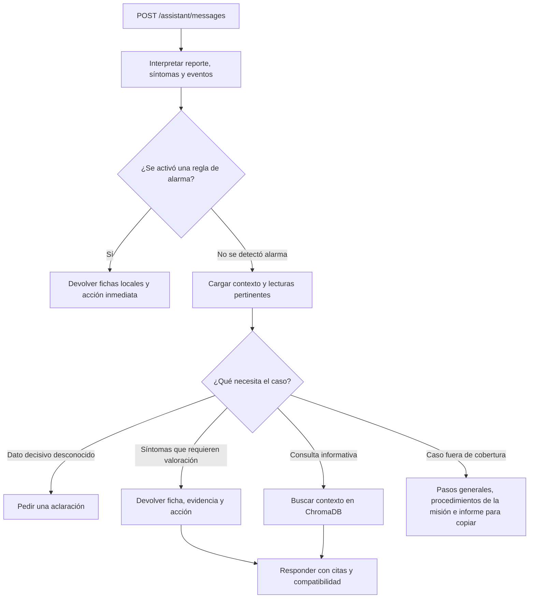

# Plan de implementación del agente médico

NASA Space Apps 2026 · Plan v2 · 14 de noviembre de 2026

> Documento histórico: el plan con el que se construyó el subgrafo médico. El comportamiento actual está en [ARCHITECTURE.md](ARCHITECTURE.md#3-assistant-request-initial-message); si difieren, manda el código.

## 1. Alcance

Implementar **16 rutas clínicas u operativas** en un solo subgrafo médico de LangGraph, detrás del `POST /assistant/messages` existente. Incluye la lógica de triaje, fichas locales, consulta de lecturas, ingesta del corpus público para ChromaDB y pruebas del endpoint. El plan cubre la ejecución con casos sintéticos del hackathon. Para uso real, un responsable clínico tendría que revisar las fichas y validar los criterios con el equipo y los procedimientos de la misión.

La unidad de entrada es el **síntoma o evento reportado**. La respuesta separa el hallazgo, los escenarios compatibles o que requieren descarte, la evidencia disponible y la acción. Usar `compatible`, `rule_out` o `insufficient_evidence` por hipótesis. Un riesgo que requiere descarte no implica que sea la causa más probable. Cualquier candidato mostrado debe venir del catálogo revisado de la ficha y tener un motivo explícito. Las probabilidades numéricas requieren un modelo clínico validado y calibrado para su población, instrumentos y uso. [BMJ, evaluación externa de modelos predictivos](https://www.bmj.com/content/384/bmj-2023-074820)

## 2. Contrato y estados del POST

Mantener los campos y comportamientos que ya ofrece el stub. Incorporar estos campos donde hagan falta.

| Campo | Dirección | Uso |
|---|---|---|
| `astronaut_id`, `message` | Entrada | Identifica la persona evaluada y el reporte o consulta. También admite reportes de un compañero. |
| `reported_symptoms` | Entrada opcional | Observaciones estructuradas, con síntoma, estado `present`, `absent` o `unknown`, inicio, severidad, persistencia y contexto cuando se conozcan. Puede reenviarse junto con el texto original para responder una aclaración. |
| Evento operativo | Datos del servidor o fixture del demo | ID, tipo, origen, hora, estado y procedencia. Un texto que reporte una alerta se conserva como “reportada”. Un evento confirmado proviene de la fuente operativa. |
| `workflow`, `answer` | Salida | `medical` y texto de la respuesta. |
| `urgency`, `action`, `protocol_id` | Salida | Urgencia y acción principal aprobadas por la ficha. Mantener un ID principal aunque haya varias señales de alarma. |
| `matched_rules`, `findings`, `possible_causes` | Salida | Reglas activadas, evidencia disponible y candidatos trazables. Cada candidato lleva estado, evidencia a favor, dato faltante y fuente. Permitir una lista vacía. |
| `needs_clarification`, `clarifying_question`, `data_warnings`, `sources` | Salida | Una pregunta enfocada cuando cambie el siguiente paso. Advertencias de lecturas y referencias con título, sección y URL. |

Usar `immediate` para una emergencia (procedimiento de emergencia de la misión y pasos con fuente), `review_required` para actuar con los pasos con fuente y vigilar (no hay responsable clínico a bordo; fichas v2.0.0), `undetermined` cuando falte un dato decisivo e `informational` para información general. Cuando la fuente pida valoración rápida sin una alarma inmediata, la ficha expresa esa prioridad en `action` sin fijar un plazo arbitrario. El POST informa a quién avisar. El estado de “enviado” se reserva para un futuro componente de transmisión que confirme la entrega.

## 3. Flujo de LangGraph

1. **Interpretar el reporte.** Distinguir síntomas actuales, históricos, negados, hipotéticos y reportados por otra persona. Un signo agudo que ya cedió puede seguir activando una alarma, según la ficha. Evaluar la alarma con los campos estructurados y las frases de alarma cubiertas por las pruebas del demo, incluida la negación (“no me falta el aire”). Ollama puede apoyar la extracción posterior, con validación contra lo que dijo el usuario. Su ausencia conserva las rutas explícitas y de revisión.
2. **Resolver alarmas primero.** Evaluar todas las reglas compatibles antes de pedir datos. Si coinciden varias, devolver la instrucción de avisar de inmediato, la ficha principal y las señales adicionales pertinentes. Deduplicar acciones. En peligro inmediato, priorizar falta de respuesta o respiración anormal y las alertas operativas que requieran una acción de la tripulación. La prioridad ordena la presentación y conserva las señales adicionales. Una lectura normal, vieja o ausente no cancela una alarma por síntomas o por un evento de la nave.
3. **Cargar solo datos pertinentes.** El flujo usa el repositorio existente si está disponible. Para las pruebas puede inyectarse un proveedor sintético. Pulso y SpO₂ llevan valor, unidad, hora UTC, contexto, calidad y procedencia. Aplicar los 300 s provisionales de vigencia del demo desde la política en SQLite cuando esté disponible. Los rangos terrestres son referencias visuales. La ausencia de señal o de una medición válida aumenta la incertidumbre.
4. **Dar la acción y explicar.** Las fichas versionadas fijan el siguiente paso, las condiciones candidatas admisibles y su evidencia mínima. ChromaDB aporta contexto cuando ayuda a una explicación o a una consulta educativa. Ollama redacta sobre ese contexto con un plazo limitado. Si falla, puede devolverse el texto conservado de la ficha o el resumen recuperado. Cada cita debe corresponder a una ficha o un chunk recuperado. Ante contexto insuficiente, declarar qué dato falta o pedir valoración según corresponda.
5. **Conservar independencia de las alarmas.** La rama prioritaria usa fichas locales y entradas disponibles en la petición o confirmadas por la aplicación. No espera una consulta a SQLite, ChromaDB, Ollama o Tierra para devolver una alarma ya identificada. El grafo padre mapea el estado al subgrafo médico y devuelve su respuesta por el mismo POST. [LangGraph, subgrafos](https://docs.langchain.com/oss/python/langgraph/use-subgraphs)

## 4. Catálogo completo de fichas

**Fichas v2.0.0 (misión sin personal clínico a bordo, enlace con tierra no garantizado).** La misión no lleva responsable médico. En esta tabla, **aviso inmediato** = emergencia: mostrar el procedimiento de emergencia de la misión y los pasos con fuente. **Valoración** = seguir los pasos con fuente, vigilar y copiar el informe para control de misión cuando haya enlace. Cada acción de ficha lleva pasos citados separados en `self` (un astronauta despierto y solo), `crew` (otro tripulante) y `equipment` (equipo o botiquín), el procedimiento de la misión al que apunta (ninguno está cargado en el asistente, así que se muestra como no cargado) y la guía que falta, escrita de forma explícita. Fuentes añadidas en v2: [MedlinePlus: sangrado, primeros auxilios](https://medlineplus.gov/ency/article/000045.htm) · [MedlinePlus: quemaduras, primeros auxilios](https://medlineplus.gov/ency/article/000030.htm) · [MedlinePlus: dolor abdominal, cuidados](https://medlineplus.gov/ency/article/003120.htm); además, fuentes ya citadas en otras fichas se reutilizan donde respaldan un paso (FDA oxímetros en palpitaciones, CDC ictus en mareo, MedlinePlus problemas respiratorios en fiebre). Los disparadores son escenarios de aceptación del demo, no una lista exhaustiva de signos clínicos.

| # | Ruta / ficha | Qué la activa y qué puede mostrar | Acción y criterio de escalamiento | Fuentes para escribir la ficha |
|---|---|---|---|---|
| 1 | `breathing_difficulty` | Falta de aire real. Distinguir inicio, intensidad, progresión y contexto. Puede mostrar dificultad respiratoria reportada, lectura dudosa o baja y, con contexto suficiente, una causa respiratoria a valorar. Una SpO₂ baja es un hallazgo. | Aviso inmediato si es intensa o repentina, incluso con 97 %, dato viejo o sensor caído. Si es nueva y carece de señales de alarma identificadas, pedir valoración. Ante una lectura aislada con señal pobre y síntomas desconocidos, preguntar por síntomas y contrastar la medición. | [MedlinePlus: primeros auxilios respiratorios](https://medlineplus.gov/ency/article/000007.htm) · [FDA: oxímetros](https://www.fda.gov/medical-devices/products-and-medical-procedures/pulse-oximeters) |
| 2 | `chest_pain` | Dolor, presión o molestia torácica nueva o inexplicada. Síndrome coronario agudo como causa prioritaria que requiere descarte si el patrón es preocupante. | Aviso inmediato ante presión o dolor sugestivos, sobre todo si persiste, reaparece o se acompaña de disnea, sudor frío o mareo. Ante dolor nuevo sin contexto suficiente para distinguir causas, indicar valoración. | [CDC: síntomas de infarto](https://www.cdc.gov/heart-disease/about/heart-attack.html) · [MedlinePlus: dolor torácico](https://medlineplus.gov/chestpain.html) |
| 3 | `palpitations` | Palpitaciones o pulso llamativo. Considerar respuesta al esfuerzo si coincide con actividad, artefacto si hay señal deficiente y arritmia por descartar si hay síntomas compatibles. El pulso no sustituye un ECG. | Aviso inmediato si se acompaña de dolor torácico, falta de aire importante o pérdida de conciencia. Si son nuevas, repetidas o persistentes, pedir valoración. Con una lectura aislada dudosa, pedir contexto y repetir si la ficha aplica. | [MedlinePlus: palpitaciones](https://medlineplus.gov/ency/article/003081.htm) · [MedlinePlus: arritmia](https://medlineplus.gov/arrhythmia.html) |
| 4 | `neurologic_red_flags` | Alteración súbita del habla, asimetría facial, debilidad de un lado, pérdida súbita de visión o dolor de cabeza súbito e intenso. Posible evento neurológico agudo. Ictus o AIT requiere descarte ante señales focales, aunque ya hayan cedido. | Aviso inmediato. Registrar la hora conocida de inicio si está disponible, sin demorar la acción. Un dolor de cabeza sin esos signos entra por su propio contexto o por la ruta de cabina. | [CDC: signos de ictus](https://www.cdc.gov/stroke/signs-symptoms/) · [MedlinePlus: dolor de cabeza](https://medlineplus.gov/headache.html) |
| 5 | `loss_of_consciousness_or_seizure` | Tripulante que no responde, pérdida de conciencia, desmayo o convulsión observada. Diferenciar pérdida de conciencia actual, episodio resuelto y evento convulsivo. | Aviso inmediato si no responde, hay una primera convulsión, dura más de cinco minutos, se repite sin recuperación o hay dificultad para respirar o despertar. Si hubo desmayo con recuperación, pedir valoración y comprobar si coinciden señales cardíacas, neurológicas o un golpe. | [MedlinePlus: pérdida de conciencia](https://medlineplus.gov/ency/article/000022.htm) · [CDC: convulsiones](https://www.cdc.gov/epilepsy/first-aid-for-seizures/) |
| 6 | `severe_allergic_reaction` | Hinchazón de lengua o garganta, dificultad respiratoria u otros signos de reacción grave tras posible exposición. Posible anafilaxia cuando el cuadro es compatible. | Aviso inmediato con compromiso respiratorio o de garganta. Mostrar la ficha autorizada de la misión cuando exista. Con síntomas limitados y sin datos suficientes, pedir valoración o aclarar la evolución. | [MedlinePlus: anafilaxia](https://medlineplus.gov/anaphylaxis.html) |
| 7 | `fever_or_respiratory_illness` | Fiebre reportada, tos o malestar. Mostrar posible infección respiratoria si el conjunto es compatible. Pedir temperatura corporal y hora si existen. La temperatura de orina pertenece a la muestra. | Aviso inmediato si coincide con dificultad respiratoria intensa, confusión nueva o fiebre con rigidez cervical. Si persiste o empeora, pedir valoración. | [MedlinePlus: fiebre](https://medlineplus.gov/ency/article/003090.htm) · [CDC: síntomas y señales de alarma de virus respiratorios](https://www.cdc.gov/respiratory-viruses/about/) |
| 8 | `dizziness_or_space_motion_sickness` | Mareo o sensación de giro. Preguntar por inicio, ingesta, pérdidas de líquidos, movimiento y fase de misión. Considerar cinetosis espacial si el contexto lo sustenta y deshidratación si hay pérdidas o baja ingesta. | Disparar la ficha neurológica ante debilidad de un lado o alteración del habla y la de pérdida de conciencia si aplica. Si persiste, interfiere con actividades o el contexto es insuficiente, pedir valoración. | [NASA: Space Adaptation Sickness](https://www.nasa.gov/wp-content/uploads/2025/09/ochmo-mtb-004-space-adaptation-sickness-sas.pdf) · [MedlinePlus: mareo y vértigo](https://medlineplus.gov/spanish/dizzinessandvertigo.html) |
| 9 | `vomiting_diarrhea_or_dehydration` | Vómitos, diarrea, pérdidas o baja ingesta. Considerar deshidratación según contexto y cuadro gastrointestinal según los síntomas. Preguntar si tolera líquidos y qué tanto ha podido orinar, cuando cambie la acción. | Aviso inmediato con confusión nueva, pérdida de conciencia o sangre en vómito. Si no logra retener líquidos, orina poco o los síntomas persisten, pedir valoración pronta. Una lectura urinaria aislada no cuantifica hidratación. | [MedlinePlus: deshidratación](https://medlineplus.gov/dehydration.html) · [Náuseas y vómitos](https://medlineplus.gov/nauseaandvomiting.html) · [Diarrea](https://medlineplus.gov/diarrhea.html) |
| 10 | `abdominal_pain_or_gi_bleeding` | Dolor abdominal, vómito con sangre o sangre en heces. Mostrar dolor localizado o posible sangrado como hallazgos. Si el patrón es leve, considerar una causa digestiva únicamente con evidencia suficiente. | Aviso inmediato ante dolor repentino e intenso, vómito con sangre o heces negras alquitranadas reportadas. Para dolor persistente o focal que empeora, pedir valoración pronta. | [MedlinePlus: dolor abdominal](https://medlineplus.gov/abdominalpain.html) · [MedlinePlus: sangrado](https://medlineplus.gov/bleeding.html) |
| 11 | `heat_illness` | Síntomas tras calor o esfuerzo intenso. Considerar agotamiento por calor, calambres por calor o golpe de calor a descartar según la combinación de síntomas. | Aviso inmediato ante confusión o colapso con exposición al calor. Si hay síntomas compatibles y sigue consciente, pedir valoración y mostrar la ficha prevista para ese caso. La temperatura corporal, si se conoce, proviene de una fuente independiente. | [CDC/NIOSH: enfermedades por calor](https://www.cdc.gov/niosh/heat-stress/about/illnesses.html) |
| 12 | `urinary_symptoms` | Ardor o urgencia al orinar → posible infección de vejiga. Fiebre o escalofríos con dolor de costado → posible infección renal. Dolor de costado intenso en oleadas o sangre visible → cálculo entre las causas. Incapacidad súbita de orinar → posible retención aguda. | Aviso inmediato ante incapacidad súbita para orinar. Pedir valoración pronta ante fiebre con dolor de costado, dolor intenso o sangre visible. Si coincide una señal global de alarma, se refleja en la misma respuesta. pH, conductividad y RGB por sí solos quedan como características de la muestra. | NIDDK: [vejiga](https://www.niddk.nih.gov/health-information/urologic-diseases/bladder-infection-uti-in-adults/symptoms-causes), [riñón](https://www.niddk.nih.gov/health-information/urologic-diseases/kidney-infection-pyelonephritis/symptoms-causes), [cálculos](https://www.niddk.nih.gov/health-information/urologic-diseases/kidney-stones/symptoms-causes), [retención](https://www.niddk.nih.gov/health-information/urologic-diseases/urinary-retention/symptoms-causes) |
| 13 | `muscle_symptoms` | Dolor muscular, calambres o debilidad. Considerar sobreesfuerzo si el contexto acompaña. Dolor muscular intenso, debilidad o color té/cola reportado después de esfuerzo o calor puede requerir descartar rabdomiólisis. | Pedir valoración médica inmediata si el patrón hace sospechar rabdomiólisis. Una medición muscular con método pendiente o un valor RGB aislado nunca activa esa hipótesis. Debilidad focal súbita se maneja por la ruta neurológica. | [CDC/NIOSH: rabdomiólisis](https://www.cdc.gov/niosh/rhabdo/signs-symptoms/) · [MedlinePlus: calambres musculares](https://medlineplus.gov/musclecramps.html) |
| 14 | `injury_bleeding_or_burn` | Golpe, lesión, sangrado o quemadura reportados. Separar mecanismo, estado de conciencia y si el sangrado continúa. Una contusión o conmoción son hipótesis que requieren evidencia del evento y síntomas pertinentes. | Aviso inmediato ante sangrado abundante que continúa, quemadura grave o señales de alarma tras un golpe en la cabeza, como vómitos repetidos o confusión que empeora. Para otras lesiones, devolver la ficha o pedir valoración según los datos disponibles. | [OMS/ICRC: atención básica de emergencia](https://www.who.int/publications/i/item/9789241513081) · [CDC: señales tras un golpe](https://www.cdc.gov/heads-up/signs-symptoms/index.html) · [MedlinePlus: quemaduras](https://medlineplus.gov/burns.html) |
| 15 | `cabin_environment_alert` | Alerta operativa de aire/presión o reporte de varios tripulantes con síntomas simultáneos en un contexto compatible. Si existe evidencia de una fuente, considera exposición ambiental por descartar. La clasificación conserva el tipo de alarma: presión, humo, CO₂ u otra. | Aviso inmediato ante alarma confirmada o sospecha operacional grave. Remitir al procedimiento de la nave y avisar a la tripulación y a control de misión si hay enlace. Nunca sustituir esa evaluación por una SpO₂ normal. | [NASA: dióxido de carbono](https://www.nasa.gov/ochmo-tb-004-carbon-dioxide-2/) · [CDC: monóxido de carbono y límites de oximetría convencional](https://www.cdc.gov/carbon-monoxide/hcp/clinical-guidance/index.html) |
| 16 | `radiation_alert` | Evento de dosímetro o alerta de nave, real o simulado y etiquetado. Mostrar alerta o posible exposición según el origen y estado del evento. Si es solo un mensaje, conservar la distinción entre reporte y confirmación. | Si hay alerta activa, avisar y mostrar el procedimiento de la misión disponible. Sin evento ni dosimetría disponible, comunicar qué evidencia falta. Los síntomas aislados y el módulo de orina no aportan una estimación de exposición. | [NASA: Artemis II, sensores y dosímetros](https://www.nasa.gov/wp-content/uploads/2026/01/a2-reference-guide-012825.pdf) · [CDC: síndrome agudo por radiación](https://www.cdc.gov/radiation-emergencies/signs-symptoms/acute-radiation-syndrome.html) · [CDC: análisis de radionúclidos en orina](https://www.cdc.gov/radiation-emergencies/php/population-monitoring/urine-radionuclide-screening.html) |

Se agregan dos salidas comunes: **consulta educativa**, con citas, y **caso fuera de cobertura**, con indicación de revisión humana. La [Tabla E.2-2 de NASA-STD-3001](https://www.nasa.gov/reference/appendix-e-health-and-medical-care-technical-requirements/) orienta la selección de escenarios relevantes para el espacio. Sus frecuencias por misión describen planeación y no son probabilidades para un astronauta con síntomas. El rol del responsable médico a bordo se documenta en [NASA-STD-3001, entrenamiento](https://www.nasa.gov/reference/5-0-training/).

## 5. Corpus que pasa a ChromaDB

### MedlinePlus/NLM: importación por Health Topic XML

Descargar el [Health Topic XML oficial](https://medlineplus.gov/xml.html). Seleccionar cada registro por su URL inglesa verificada y usar el enlace de idioma alterno del XML para obtener el equivalente español cuando exista. Extraer el título, el resumen, los encabezados disponibles y la URL. Atribuir los resúmenes a MedlinePlus.gov y aplicar sus [condiciones de reutilización](https://medlineplus.gov/about/using/usingcontent/). Los enlaces a la enciclopedia A.D.A.M. pueden figurar como referencias de las fichas, con su propio régimen de reutilización. El importador no copia su contenido.

| Temas que se indexan | Para qué sirven |
|---|---|
| [Breathing Problems](https://medlineplus.gov/breathingproblems.html), [Chest Pain](https://medlineplus.gov/chestpain.html), [Arrhythmia](https://medlineplus.gov/arrhythmia.html) | Explicar el síntoma respiratorio, dolor de pecho y diferencia entre palpitación y alteración del ritmo. |
| [Stroke](https://medlineplus.gov/stroke.html), [Headache](https://medlineplus.gov/headache.html), [Fainting](https://medlineplus.gov/fainting.html), [Seizures](https://medlineplus.gov/seizures.html) | Contexto educativo para síntomas focales, dolor de cabeza, desmayo y evento convulsivo. |
| [Anaphylaxis](https://medlineplus.gov/anaphylaxis.html), [Fever](https://medlineplus.gov/fever.html) | Contexto para reacción grave y síntomas febriles. |
| [Dizziness and Vertigo](https://medlineplus.gov/dizzinessandvertigo.html), [Motion Sickness](https://medlineplus.gov/motionsickness.html), [Dehydration](https://medlineplus.gov/dehydration.html), [Nausea and Vomiting](https://medlineplus.gov/nauseaandvomiting.html), [Diarrhea](https://medlineplus.gov/diarrhea.html), [Abdominal Pain](https://medlineplus.gov/abdominalpain.html) | Distinguir descripciones de mareo, pérdidas de líquidos y síntomas digestivos. La cinetosis espacial usa adicionalmente el brief de NASA. |
| [Urinary Tract Infections](https://medlineplus.gov/urinarytractinfections.html), [Kidney Stones](https://medlineplus.gov/kidneystones.html), [Muscle Cramps](https://medlineplus.gov/musclecramps.html) | Explicar signos urinarios, cálculo y calambres en lenguaje sencillo. |
| [Head Injuries](https://medlineplus.gov/headinjuries.html), [Bleeding](https://medlineplus.gov/bleeding.html), [Burns](https://medlineplus.gov/burns.html), [Carbon Monoxide Poisoning](https://medlineplus.gov/carbonmonoxidepoisoning.html) | Contexto sobre lesiones y exposición ambiental. |

### Fuentes complementarias: resúmenes propios y citados

Usar las páginas exactas de la tabla de fichas. Guardar cada resumen curado junto con su URL y sección para que la ingesta sea reproducible.

| Fuente | Chunks propuestos y propósito |
|---|---|
| FDA, **Pulse Oximeters** | Tres: qué estima el oxímetro, cómo obtener una lectura según las instrucciones del equipo y factores que alteran la lectura. |
| CDC, **infarto**, **ictus**, **convulsión** y **golpe en la cabeza** | Uno o dos por tema: señales compatibles y señales de alarma, manteniendo juntas las condiciones y sus excepciones. |
| CDC/NIOSH, **calor** y **rabdomiólisis** | Separar agotamiento, golpe de calor y rabdomiólisis. Para rabdomiólisis, distinguir señales de sospecha de confirmación clínica. |
| NIDDK, **infección de vejiga**, **infección renal**, **cálculos** y **retención urinaria** | Un resumen independiente por condición sobre síntomas y datos que justifican valoración. Incluir un bloque separado para retención aguda si hace falta. |
| NASA, **Space Adaptation Sickness** y **Carbon Dioxide** | Cinetosis: contexto de misión y síntomas observados. Cabina: qué puede motivar una comprobación ambiental y qué puede afirmar el asistente sin medición. |
| CDC, **monóxido de carbono**, **síndrome agudo por radiación** y **radionúclidos en orina**. NASA, **Artemis II** | Separar cuatro ideas: señales de posible exposición ambiental, concepto de exposición y dosis, alcance de las pruebas urinarias de laboratorio, y procedencia de datos de dosimetría. |

El material OMS/ICRC y la tabla de NASA-STD-3001 sirven para revisar el diseño de las fichas y su cobertura. Los procedimientos operativos de la nave son fichas con ID y versión, y se cargan directamente desde el subgrafo.

### Cómo partir, vectorizar y consultar

1. Una idea y un idioma por chunk. Conservar el resumen completo si ya es breve. Para secciones largas, tomar **150–300 tokens como objetivo inicial**, cortar en párrafos o encabezados y conservar juntas las condiciones y excepciones. Sin solapamiento fijo inicial. Anteponer título y sección al texto que se vectoriza.
2. Guardar `chunk_id` estable, `source_id`, `source_title`, `source_url`, `section`, `topic`, `language`, `source_version` o fecha de captura, y `reuse_basis`. El manifiesto define exactamente qué se importa. Una reingesta actualiza los IDs existentes y retira los fragmentos eliminados del manifiesto.
3. Usar [`bge-m3` local con Ollama](https://ollama.com/library/bge-m3) como candidato inicial. Fijar la versión del modelo y usarla para documentos y consultas en la colección `medical_guides`. En [ChromaDB](https://docs.trychroma.com/docs/querying-collections/query-and-get), filtrar por tema si está claro, preferir el idioma del reporte y usar otro idioma cuando falte material pertinente. Evaluar al menos una consulta positiva y una difícil por familia. Revisar si la fuente esperada aparece entre los tres primeros resultados y si el texto realmente respalda la respuesta.
4. El vector representa similitud de texto. La selección de ficha, la urgencia y los candidatos clínicos dependen de las reglas versionadas. El corpus se carga desde fuentes públicas. Las consultas de recuperación se formulan por tema, sin conservar en ChromaDB mensajes personales, identificadores ni mediciones.

## 6. Datos y frontend

| Entrada disponible | Regla del backend |
|---|---|
| Pulso y SpO₂ | Evidencia complementaria con contexto, antigüedad, fuente y calidad. Si salen del mismo dispositivo, registrar su origen común. No confundir una medición fuera de referencia con una causa. |
| pH, conductividad o salinidad, RGB y temperatura de muestra | Datos descriptivos si están disponibles. Las rutas urinarias o de hidratación se activan por síntomas y contexto. No inferir sangre visible, temperatura corporal, infección ni radiación a partir de estas señales. |
| Sensor muscular | Mostrar que el método y la unidad están pendientes. Las rutas musculares se basan en el reporte, con revisión clínica si aplica. |
| Alerta de cabina o radiación | Consumir un evento tipado de la aplicación, o inyectar uno sintético en el demo. Si se reporta por texto, etiquetarlo como reportado. |

La integración de frontend queda documentada para una siguiente etapa. Tauri enviará el `astronaut_id`, texto y síntomas estructurados al POST, mostrará primero acción y urgencia, y después evidencia y fuentes. Para aclaraciones, reenviará el reporte previo y el dato nuevo al mismo endpoint. La futura consola base recibirá el incidente según su contrato de telemetría y mostrará el estado confirmado de entrega.

## 7. Implementación y aceptación

| Paso | Entregable |
|---|---|
| 1 | Esquemas del POST, adaptación del grafo padre y contrato de respuesta. Código en el módulo del asistente, siguiendo la estructura FastAPI que ya tenga el repo. |
| 2 | Catálogo de las 16 fichas en `assistant/workflows/medical/protocols/`. Estado, reglas y grafo en `state.py`, `triage.py` y `graph.py`. Las fichas comparten un esquema de ID, versión, disparadores, acción, preguntas, candidatos, evidencia y fuentes. |
| 3 | Integrar lectura de contexto, avisos de calidad, detección de negación y concurrencia de alertas. Reutilizar adaptadores existentes para SQLite, ChromaDB y Ollama. |
| 4 | Poblar e indexar el manifiesto de fuentes. Añadir la rama educativa y comprobar citas y abstención cuando la evidencia no alcance. |
| 5 | Probar el POST con casos sintéticos en Swagger o pruebas automatizadas. Probar las 16 rutas y las dos salidas comunes. |

**Criterios transversales**

- Verificar una activación válida y un caso cercano que no active esa ficha para cada ruta. Añadir combinaciones simultáneas y reportes negativos, históricos e hipotéticos.
- Probar dificultades respiratorias intensas con SpO₂ de 97 %, debilidad súbita que ya cedió, mareo durante adaptación sin signos de alarma, y mareo con alteración del habla. Verificar que el caso urgente produce la acción inmediata aun con dependencias apagadas.
- Probar fiebre y dolor de costado, incapacidad súbita para orinar, dolor muscular tras esfuerzo con orina color cola reportada, y RGB anómalo aislado. El último no debe declarar una causa clínica.
- Probar alerta de dosimetría confirmada, alerta simulada y pregunta sobre radiación con solo datos de orina. Verificar origen, procedencia y ausencia de diagnóstico por el módulo urinario.
- Probar lecturas viejas, señal deficiente, dato ausente, repositorio no disponible, recuperación vacía y Ollama sin respuesta. Verificar que ninguna rama inventa causas, citas, porcentajes ni transmisiones.
