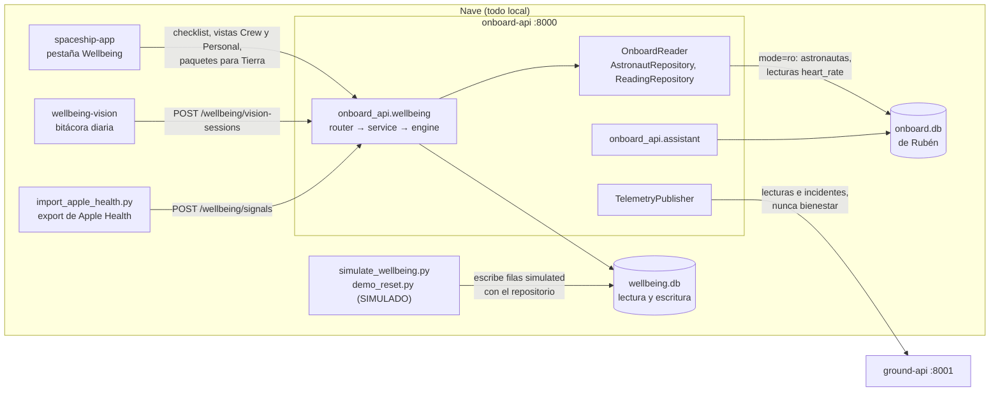

# Arquitectura del módulo de bienestar

Este documento cubre las piezas del módulo de bienestar, cómo fluyen los datos entre ellas, dónde se guardan y cómo encaja el módulo con el resto del sistema. Describe `main` al 2026-11-15. Si este documento y el código no coinciden, manda el código. La vista de todo el sistema está en [ARCHITECTURE.md](../ARCHITECTURE.md); las etiquetas de estado, en el [README](README.md).

## Componentes

| Componente | Estado | Qué hace | Dónde |
|---|---|---|---|
| Módulo `onboard_api.wellbeing` | **Implementado** | Recibe checklists, señales, sesiones de visión y co-presencia; calcula la evaluación de cada persona contra su línea base; gestiona los paquetes para Tierra. Vive dentro de `onboard-api`, en el mismo servidor (puerto 8000). | [`wellbeing/`](../../services/onboard-api/src/onboard_api/wellbeing/) |
| Proceso `wellbeing-vision` | **Implementado** (sólo bitácora) | Proceso aparte, opcional. Webcam + MediaPipe. Manda un resumen por bitácora a `POST /wellbeing/vision-sessions`. | [`services/wellbeing-vision/`](../../services/wellbeing-vision/README.md) |
| Pestaña Wellbeing de la consola (Cedric) | **Implementado** | Vistas Crew y Personal (con PIN), check-in diario y envío al psicólogo en Tierra. | [`WellbeingScreen.tsx`](../../apps/spaceship-app/src/screens/WellbeingScreen.tsx), [`screens/wellbeing/`](../../apps/spaceship-app/src/screens/wellbeing/), [`lib/wellbeing.ts`](../../apps/spaceship-app/src/lib/wellbeing.ts) |
| Datos de onboard (Rubén) | **Implementado** | Lista de astronautas y lecturas `heart_rate`, leídas en sólo lectura a través de sus repositorios. | [`onboard_reader.py`](../../services/onboard-api/src/onboard_api/wellbeing/onboard_reader.py) |
| Importador de Apple Health | **Implementado** | Lee `export.zip` / `export.xml` en streaming y manda HRV, FC en reposo y sueño a `POST /wellbeing/signals`. | [`health_import.py`](../../services/onboard-api/src/onboard_api/wellbeing/health_import.py), [`import_apple_health.py`](../../services/onboard-api/scripts/import_apple_health.py) |
| Simulador y reset de demo | **Implementado** | Historial SIMULADO de 21 días para ast-01…ast-04 y reset de la demo en un paso. | [`simulator.py`](../../services/onboard-api/src/onboard_api/wellbeing/simulator.py), [`simulate_wellbeing.py`](../../services/onboard-api/scripts/simulate_wellbeing.py), [`demo_reset.py`](../../services/onboard-api/scripts/demo_reset.py) |

Dentro del módulo:

| Archivo | Papel |
|---|---|
| [`router.py`](../../services/onboard-api/src/onboard_api/wellbeing/router.py) | Las 14 rutas. Traduce errores a `404`, `409`, `422`. |
| [`dependencies.py`](../../services/onboard-api/src/onboard_api/wellbeing/dependencies.py) | Settings, reloj, conexión a `wellbeing.db` y lector de `onboard.db`. Separado de `onboard_api.dependencies` a propósito (ese archivo es de otro equipo). |
| [`service.py`](../../services/onboard-api/src/onboard_api/wellbeing/service.py) | Une almacenamiento, datos de onboard y motor. Valida que el astronauta exista y que el día no sea futuro. |
| [`engine.py`](../../services/onboard-api/src/onboard_api/wellbeing/engine.py) | La fusión: funciones puras sobre datos en memoria. Ver [fusion.md](fusion.md). |
| [`repository.py`](../../services/onboard-api/src/onboard_api/wellbeing/repository.py), [`database.py`](../../services/onboard-api/src/onboard_api/wellbeing/database.py) | SQL de `wellbeing.db` y conexiones. |
| [`schemas.py`](../../services/onboard-api/src/onboard_api/wellbeing/schemas.py) | Modelos Pydantic del contrato. La consola los replica en [`api/types.ts`](../../apps/spaceship-app/src/api/types.ts). |
| [`settings.py`](../../services/onboard-api/src/onboard_api/wellbeing/settings.py) | Variables `WELLBEING_*` y la zona de misión. |
| [`checkin_form.py`](../../services/onboard-api/src/onboard_api/wellbeing/checkin_form.py) | Preguntas del checklist (escritas por el equipo, no copiadas de un cuestionario estandarizado). |

## Flujo de datos

Una petición de lectura (por ejemplo `GET /astronauts/ast-02/wellbeing`):

1. `dependencies.py` abre `wellbeing.db` (y la migra si es la primera vez en este proceso) y abre `onboard.db` en sólo lectura. Si `onboard.db` no existe, responde `503` y no la crea.
2. `service.py` comprueba que el astronauta exista en `onboard.db` (`404` si no) y carga **todo** su historial: checklists, señales, visión, co-presencia y lecturas `heart_rate`.
3. `engine.py` agrupa por día de misión, calcula líneas base, z y rachas, y devuelve nivel, indicadores y notas.

La evaluación se calcula en cada petición; no hay resultados guardados. La consola consulta la vista Crew cada 30 s ([`CrewView.tsx`](../../apps/spaceship-app/src/screens/wellbeing/CrewView.tsx)).

Quién escribe qué:

| Entrada | Quién la manda hoy en `main` |
|---|---|
| Checklist (`PUT …/checkins/{day}`) | La consola (pantalla de check-in). |
| Señales (`POST /wellbeing/signals`) | El importador de Apple Health; `demo_reset.py` con el export sintético. |
| Bitácora de visión (`POST /wellbeing/vision-sessions`, `bitacora`) | `wellbeing-vision`. El simulador también genera bitácoras simuladas hasta ayer. |
| Movimiento en modo ambiente (`ambiente`) y co-presencia (`POST /wellbeing/co-presence`) | `wellbeing-vision ambiente`, en ventanas de 60 s. El simulador genera la historia de días anteriores (ventanas de 10 min). |
| Pulso (`heart_rate` en `onboard.db`) | La parte física (sensores, `firmware/simulator.py`), por `POST /readings`. Bienestar nunca escribe ahí. |

## Bases de datos

- **`wellbeing.db` es un archivo aparte** (`WELLBEING_DB_PATH`, por defecto `data/wellbeing.db`). Tablas: `checkins`, `signals`, `vision_sessions`, `co_presence`, `co_presence_members`, `ground_packages`. Detalle en [data-dictionary.md](../../db/data-dictionary.md#data-dictionary-wellbeing-database). Por qué aparte: [decisions.md](decisions.md#2-base-de-datos-propia-wellbeingdb).
- **`onboard.db` sólo se lee** (`mode=ro`), siempre a través de `AstronautRepository` y `ReadingRepository`. Usa la misma variable `ONBOARD_DB_PATH` que el servicio onboard.
- **Migraciones:** el mismo runner que onboard (`init_db`) con `db/migrations/wellbeing/` ([`0001_baseline.sql`](../../db/migrations/wellbeing/0001_baseline.sql), [`0002_ground_packages.sql`](../../db/migrations/wellbeing/0002_ground_packages.sql)). El módulo no toca el arranque (`lifespan`) de la app: migra al abrir su primera conexión, una vez por proceso y ruta. Una base en versión 1 sube a 2 sin perder filas (test `test_existing_v1_copy_upgrades_and_keeps_data`).
- **Sin imágenes:** las sesiones de visión guardan el JSON validado (`body`) con métricas derivadas. No hay video, cuadros ni plantillas faciales: las plantillas viven sólo en el equipo de visión (`data/faces/`, ver abajo).

## Zona horaria de misión

`WELLBEING_MISSION_TZ` (nombre IANA, por defecto `UTC`, como la Estación Espacial) define el **día de misión**. Una zona desconocida falla al arrancar.

- **Se agrupa por ese día:** checklists (incluida la validación de "día futuro"), señales, visión, co-presencia, pulso, línea base, línea de tiempo, `onset_date`, el periodo de los paquetes, el importador del Watch, el simulador y `demo_reset.py`.
- **Timestamps en UTC:** se guardan y se devuelven en UTC. Los días se calculan al consultar, así que cambiar la zona reagrupa los datos sin migrar. La excepción es `checkins.day`, que se guarda tal como lo manda la consola.
- **Por qué importa:** con `UTC`, en Mexicali (`America/Tijuana`) los datos de después de las 16:00 caen en el día siguiente. El test `test_17h_tijuana_falls_on_the_local_day_only_with_mission_tz` lo cubre.
- La zona en uso sale en `GET /wellbeing/parameters` (`mission_tz`). La consola, `demo_reset.py`, `simulate_wellbeing.py` e `import_apple_health.py` la leen de ahí.
- La zona aplica a todo el módulo, no por astronauta.
- **Docker:** `docker-compose.yml` pasa `WELLBEING_MISSION_TZ` con `America/Tijuana` por defecto (PR #82), así que Docker y el camino nativo agrupan los mismos días. Se cambia con `$env:WELLBEING_MISSION_TZ` antes de `.\run.ps1` ([runbook](../wellbeing-demo-runbook.md)).

## Integración con el resto

- **Router:** `app.include_router(wellbeing_router)` en [`main.py`](../../services/onboard-api/src/onboard_api/main.py). Las rutas salen en `/docs` bajo la etiqueta `wellbeing`. No hay paso de arranque propio.
- **Aislamiento del asistente:** el paquete `onboard_api.assistant` nunca importa `onboard_api.wellbeing`, y los datos de bienestar (incluida una bitácora con fatiga y tensión extremas) no cambian el triaje médico. Lo vigila [`test_wellbeing_isolation.py`](../../services/onboard-api/tests/assistant/test_wellbeing_isolation.py).
- **Telemetría:** el contrato v1 dice que los datos de bienestar nunca se envían a Tierra ([contracts/telemetry/README.md](../../contracts/telemetry/README.md)). El publicador sólo lee `onboard.db`. Las lecturas `heart_rate` que bienestar usa sí viajan, pero como lecturas físicas de la parte de Rubén, no como datos de bienestar.
- **Docker:** `WELLBEING_DB_PATH=/data/sqlite/wellbeing.db`, en el volumen `sqlite` junto a `onboard.db` ([docker-compose.yml](../../docker-compose.yml)). El reset de la demo se corre dentro del contenedor: `docker compose exec onboard-api python scripts/demo_reset.py` ([runbook](../wellbeing-demo-runbook.md)).
- **`demo_reset.py`:** comprueba que la API responda, respalda `wellbeing.db` en `data/backups/`, vacía sus tablas (no toca `onboard.db`), carga el historial SIMULADO con semilla 7 y el export sintético del Watch para ast-01, y muestra el estado de los 4 astronautas. Es idempotente. Debe correr desde la misma carpeta que la API, para usar el mismo `wellbeing.db`.
- **Consola:** la pestaña Wellbeing nunca levanta una alarma de pestaña: el bienestar es personal ([`App.tsx`](../../apps/spaceship-app/src/App.tsx)).

## Visión

El proceso [`wellbeing-vision`](../../services/wellbeing-vision/README.md) es opcional y corre aparte de `onboard-api`. Manda sólo números: nunca guarda ni envía cuadros. Si la API no responde, los envíos quedan en `outbox/pending.jsonl` y se reintentan; los que la API rechaza (4xx) van a `outbox/rejected.jsonl`.

| Comando | Qué hace | Manda |
|---|---|---|
| `bitacora` | Bitácora diaria frente a la cámara ([`bitacora.py`](../../services/wellbeing-vision/src/wellbeing_vision/bitacora.py)). | Una sesión `bitacora` a `POST /wellbeing/vision-sessions`. |
| `enroll` | Registra la cara de un astronauta: 10 plantillas SFace en `data/faces/<astronauta>.npz`. | Nada. |
| `identify` | Vista previa con una caja por cara, su nombre o `unknown-<n>`, y su pose. | Nada. |
| `ambiente` | Modo ambiente con dos cámaras ([`ambiente.py`](../../services/wellbeing-vision/src/wellbeing_vision/ambiente.py), [`motion.py`](../../services/wellbeing-vision/src/wellbeing_vision/motion.py)). | Cada 60 s: co-presencia por módulo y una sesión `ambiente` por persona. |

### Bitácora diaria

1. Abre la cámara a 1280x720. Un recorte cuadrado alrededor de la cara (YuNet) alimenta al Face Landmarker de MediaPipe. Si la cámara deja de entregar cuadros por 2 s, la bitácora termina.
2. **Neutral del día:** 3 s seguidos con la cara cerca, quieta, relajada y mirando a la cámara. Un parpadeo, un movimiento de cabeza, hablar o mirar a otro lado lo reinicia. Se compara con un ancla de largo plazo por astronauta (mediana de los últimos 7 neutrales, sólo números, en `data/neutrals/`).
3. **Medición** durante `--seconds` (60 por defecto): parpadeos, PERCLOS, apertura de ojos frente al neutral, bostezos, cabeceos, ceño (media y pico sostenido 1 s) y labios apretados.
4. **Mirar hacia abajo no es fatiga ni tensión.** Al leer bajan los párpados y el ceño. Los cuadros que miran hacia abajo más de 0.5 s no cuentan (la vista previa dice "Look at the camera"), salvo cierres profundos de ojos, que sí cuentan como ojos cerrados.
5. **Cabeceo:** la cabeza baja más de 15° y vuelve a menos de 10° en 0.3–2 s. Quedarse con la cabeza abajo es una postura, no un cabeceo.
6. **Detector de habla:** los labios sólo se miden mientras la persona no habla. Cuenta como hablar si en 1 s hay dos aperturas de mandíbula, o dos vaivenes de `mouthPress` de 0.08 o más mientras los labios no están apretados ([`face.py`](../../services/wellbeing-vision/src/wellbeing_vision/face.py)). Una sola apertura (tragar, suspirar) no es hablar. Con menos de 10 s en silencio, los labios salen `null`.
7. **Calidad:** cuadros con la cara a menos de 160 px (`WELLBEING_VISION_MIN_FACE_PX`) no cuentan. Con `valid_frame_ratio` menor a 0.8 la sesión es `suspect`; menor a 0.5, `bad`.
8. **Identidad:** cada 10 cuadros compara la cara con la galería ([`identity.py`](../../services/wellbeing-vision/src/wellbeing_vision/identity.py)).
   - Si confirma al astronauta de `--astronaut`, sale `identity.method: "face"` con su `match_score`.
   - Si la cara coincide con otra persona, la vista previa dice "This looks like X, not Y" y **no se manda nada** (tampoco se guarda el neutral).
   - Si no hay coincidencia clara o no hay caras registradas, sale `manual`.
9. **Envío:** un resumen con `session_type: "bitacora"` y `source: "vision:cam<N>"`.

### Identidad

- YuNet encuentra las caras y SFace convierte cada una en una plantilla de 128 números, alineada por los ojos. Por eso una cara al revés coincide con un registro derecho.
- Una cara es de un astronauta si la similitud es de al menos 0.363 (el umbral publicado con SFace) y le saca 0.08 al segundo lugar (PROVISIONAL). Cada pista promedia sus últimas 10 plantillas y necesita 3 antes de recibir nombre. Las demás personas salen como `unknown-<track>`.
- **Las plantillas son datos biométricos:** viven sólo en `data/faces/` del equipo de visión (fuera de git), nunca se envían y se borran borrando el archivo.
- `onboard-api` acepta `unknown-<track>` sólo en sesiones de visión y co-presencia, y nunca les calcula línea base. Las rutas de evaluación, checklist y señales responden `404` para esos ids (PR #91).

### Modo ambiente

- **Una cámara por módulo** (cam 0 = `modulo-a`, cam 1 = `modulo-b` por defecto). Si las dos ven el mismo espacio, `--overlap` las une en un solo módulo.
- **Un astronauta cuenta una sola vez:** si dos cámaras lo ven, se queda en su módulo. Un traslado exige 10 s sin verlo en el módulo anterior y 5 s seguidos en el nuevo (PROVISIONAL).
- **Pistas por cara o por cuerpo:** cada pose se empareja con la cara que contiene su nariz, así que alguien de espaldas sigue presente con su nombre. Una pista cuenta como ocupante después de 3 s (`--min-track`, PROVISIONAL).
- **Cada 60 s, por módulo:** `POST /wellbeing/co-presence` con ocupantes, parejas (segundos juntos, distancia media en anchos de hombro y `facing_ratio`) y cobertura de cámara.
- **Cada 60 s, por persona** con 10 s o más de pose: una sesión `session_type: "ambiente"` con `identity.method: "face"`, `neutral_ok: false` y `motion` (`speed`, `stationary_ratio`, `fidget_index`, `torso_angle_dev`). Todo relativo al cuerpo, así que no cambia con la cámara ni con el astronauta de cabeza.

### Rendimiento

- Las cámaras corren en hilos paralelos y cada una guarda sólo su cuadro más reciente.
- Las caras se detectan en una copia de 960 px y las poses en una de 640 px. El reconocimiento usa el recorte de la cara a resolución completa.
- El reconocimiento sólo corre para pistas nuevas o sin confirmar: revisa una pista identificada cada 2 s y una desconocida cada 1 s.
- En la laptop de desarrollo, con dos cámaras: de 6.8 a 12.5 FPS por cámara con caras (PR #33). El runbook pide 10 FPS o más por cámara antes de la demo.

**Pendiente** de validar con cámaras reales (lo dice el PR #33): FPS y reconocimiento a 1280x720, `facing_ratio` con parejas reales y la nueva regla de habla en bitácoras nuevas.

Comandos, umbrales y captura: [wellbeing-vision/README.md](../../services/wellbeing-vision/README.md). Variables: [CONFIGURATION.md](../CONFIGURATION.md#wellbeing-vision-wellbeing_vision_).
